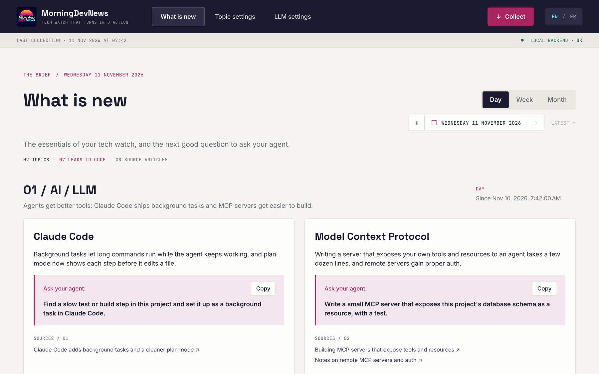
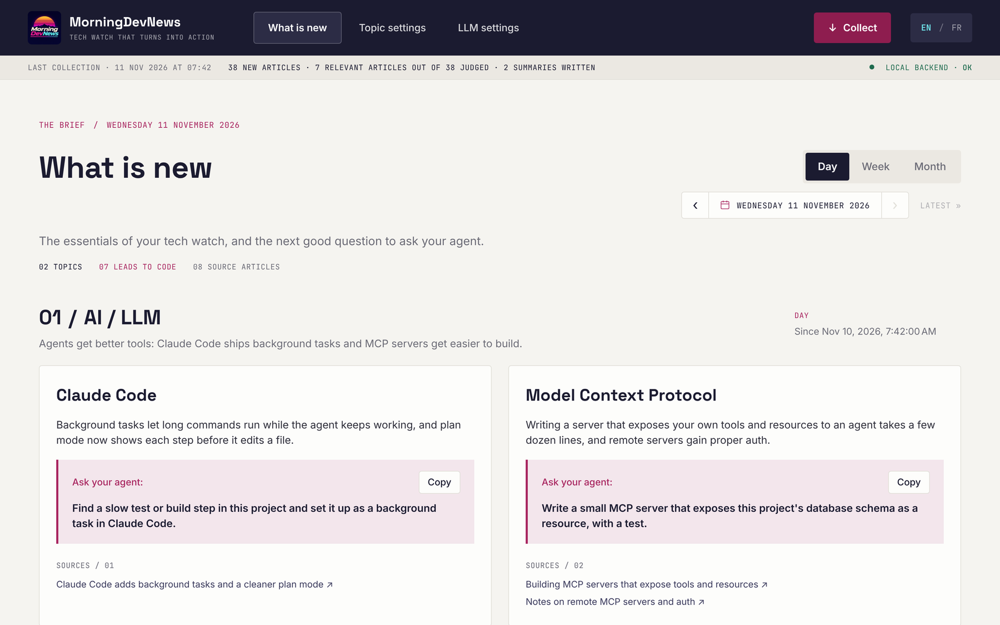
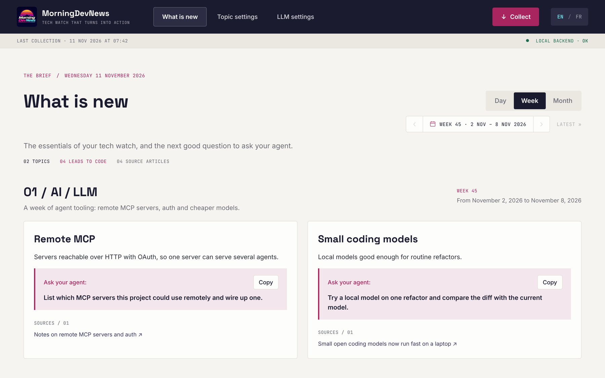
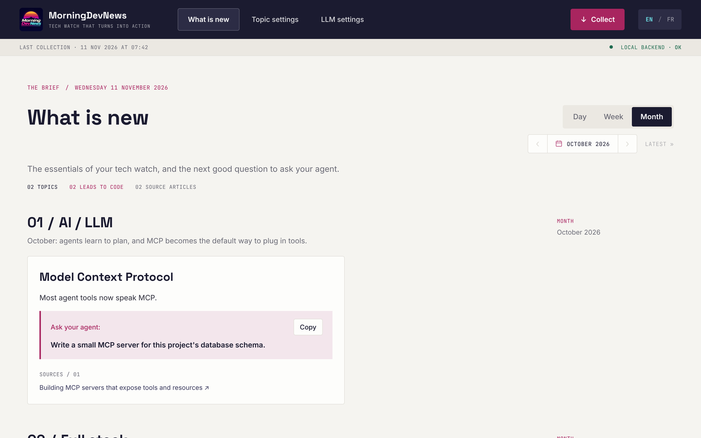
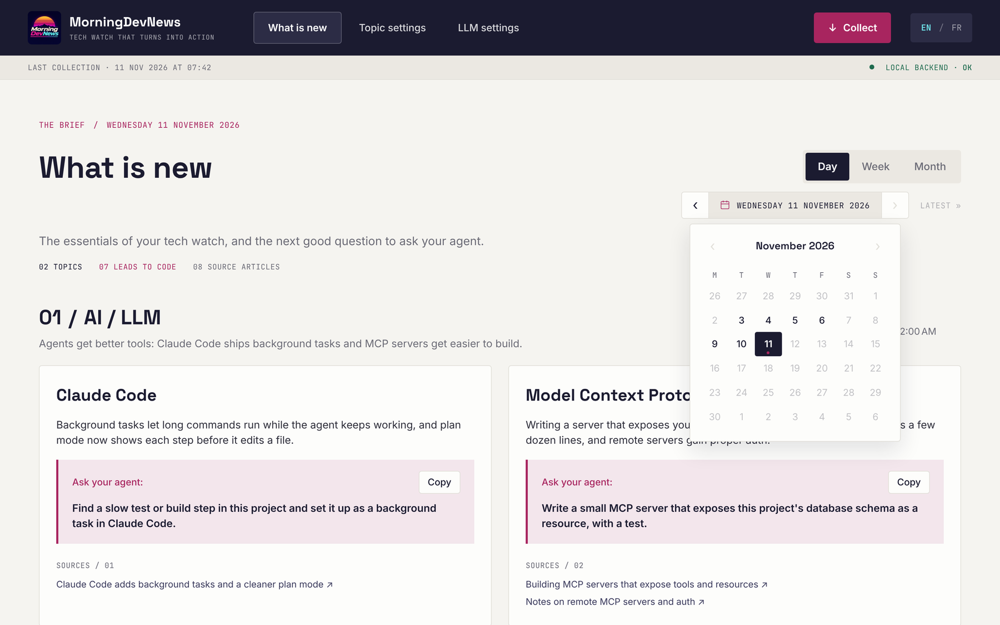
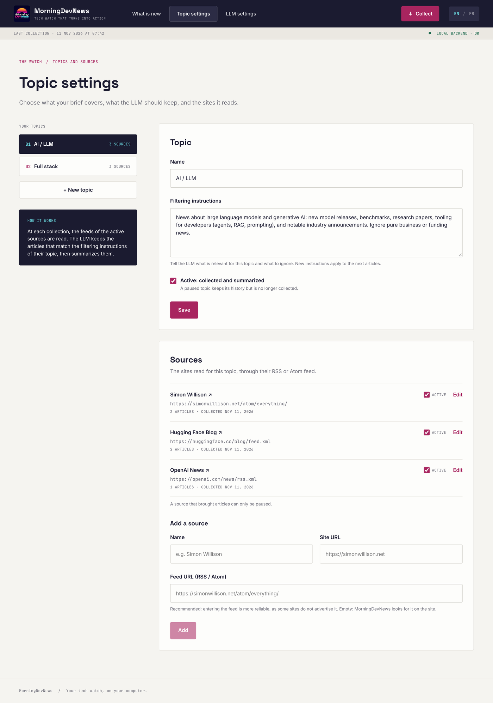
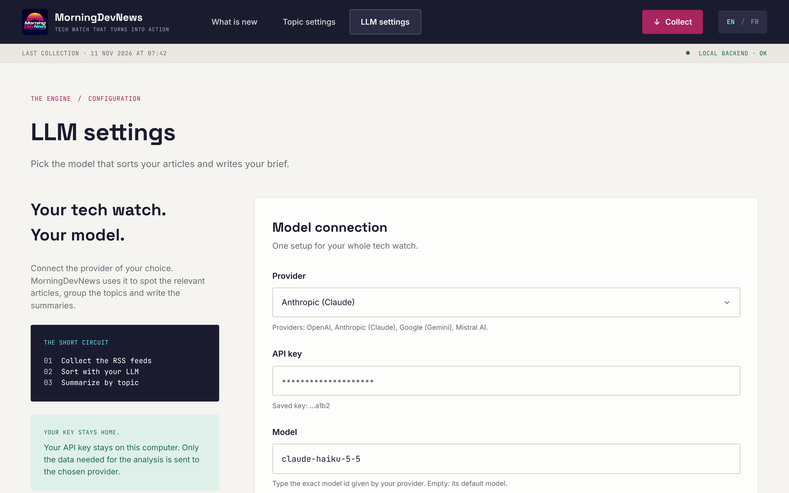

# MorningDevNews

Local tech watch app for developers. Each time you click **Collect**, it reads the RSS feeds you
picked, lets an LLM keep only the articles that matter for each of your topics, and summarizes
them into a short brief, with a ready-to-paste prompt for your coding agent on every point.

## Features

**A morning brief, by topic.** For each topic: one headline and a few points. Each point says which
tool or library changed, what is new, and what to ask your coding agent, with a Copy button and
links to the source articles.



**One click to collect.** The Collect button reads every RSS feed, lets the LLM judge which new
articles are relevant, and writes the summaries. The status bar shows what the collection did.



**Day, week and month.** Switch between the daily brief and a summary of the whole week or month.
Weekly and monthly summaries are written automatically once the period is over.

| Week | Month |
| --- | --- |
|  |  |

**Browse past briefs.** Step back with the arrows, or open the calendar and jump to any date. Days
that have a brief are in bold.



**Your topics and sources.** Create your own topics and tell the LLM in plain words what to keep and
what to ignore. Add the sites to follow by their RSS or Atom feed, or give the site address and the
app finds the feed. Pause a topic or a source without losing its history.



**Bring your own LLM.** OpenAI, Anthropic (Claude), Google (Gemini) or Mistral AI: paste your API
key, pick a model and test it. The key stays on your computer.



The interface is in English or French, and everything runs locally with a SQLite database.
Screenshots show example content.

## Structure

```
backend/    Python API (FastAPI): RSS collection, SQLite storage, LLM filtering and summaries
frontend/   Angular interface
docs/       Screenshots used in this README
start.bat   Starts everything on Windows
```

## Requirements

- Python 3.11 or newer
- Node.js 24.15 or newer (required by Angular 22)

## Quick start (Windows)

Double-click `start.bat` (or run it from a terminal). It:

1. creates the Python virtual environment `backend/.venv` and installs the backend dependencies,
2. installs the frontend dependencies on the first start, and again whenever
   `frontend/package-lock.json` changed (a new dependency after a `git pull`),
3. opens two windows, one for the backend and one for the frontend, and opens http://localhost:4200.

Close the two windows to stop the app.

## Manual start (any OS)

Two terminals, one per part.

**Backend** (from `backend/`):

```bash
python -m venv .venv
# Windows (PowerShell / cmd): .venv\Scripts\activate
# Windows (Git Bash)        : source .venv/Scripts/activate
# macOS / Linux             : source .venv/bin/activate
pip install -r requirements.txt
uvicorn app.main:app --reload
```

When the prompt starts with `(.venv)`, the environment is active.

The API answers on http://localhost:8000 (auto-generated docs at http://localhost:8000/docs).

On the first start the backend creates the SQLite database `backend/morningdevnews.db`
(ignored by Git) and inserts two example topics. Delete the file to start again from scratch.

**Frontend** (from `frontend/`):

```bash
npm install
npm start
```

Open http://localhost:4200: the status bar under the header should show "Local backend · ok".
`/api/...` calls from the frontend are forwarded to the backend by `frontend/proxy.conf.json`.

## First use

1. Open **LLM settings**, pick a provider, paste your API key, then click **Test**.
2. Open **Topic settings**: edit the two example topics or create your own, write what the LLM
   should keep and ignore, and add the sites to follow.
3. Click **Collect**. The first collection reads the feeds, judges the articles of the last
   7 days and writes the first brief on **What is new**. Collect again the next morning to get
   what is new since then.

Weekly and monthly summaries are written by the first collection after a week (Monday to Sunday)
or a month ends. Summaries are written in the interface language selected when you click Collect.

## LLM settings

The app works with OpenAI, Anthropic (Claude), Google (Gemini) or Mistral AI, through
LangChain. You choose the provider, the model and your API key on the **LLM settings** page.
The provider and the model are saved in the SQLite database; the API key is written to
`backend/.env` (variable `LLM_API_KEY`), which is ignored by Git and is only sent to the
provider you chose. You can also edit that file by hand, or use the API at
http://localhost:8000/docs:

- `PUT /api/settings` with `{"api_key": "..."}` (the provider is guessed from the key prefix,
  except for Mistral: add `"provider": "mistralai"`), and optionally `"model"`;
- `POST /api/settings/test` checks that the key and the model work.

## Languages

The project is written in English (code, comments, docs). The interface is in English by
default and can be switched to French with the selector at the top of the page; the choice
is remembered by the browser. Texts live in `frontend/src/app/core/i18n/translations.ts`:
to add a text, add its key to `en` and to `fr` (TypeScript reports a missing translation).
